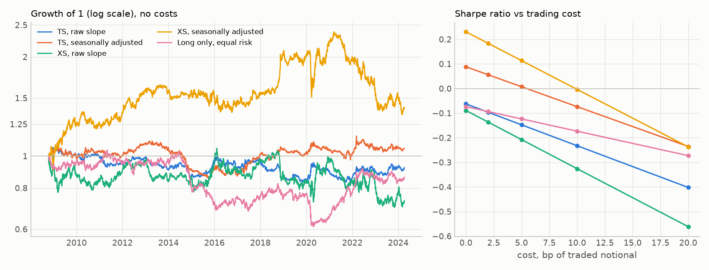
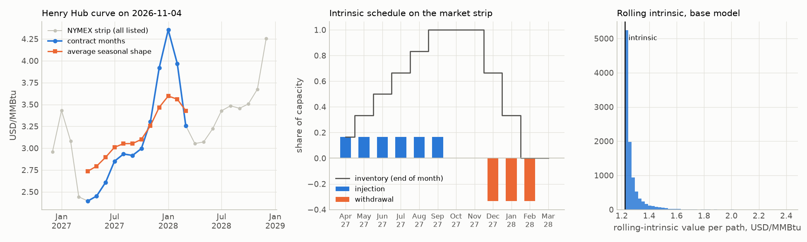
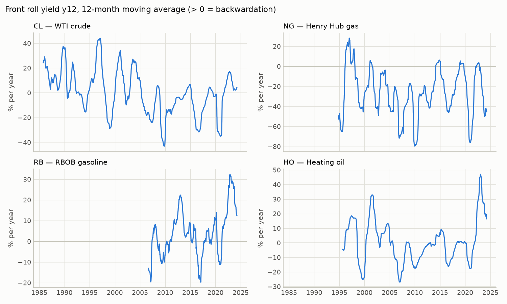
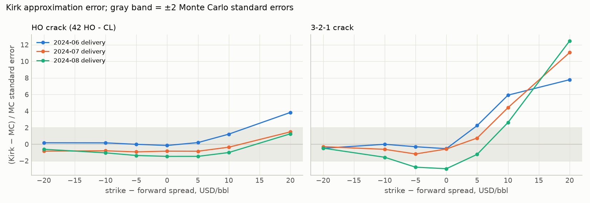

# Commodities: curves, carry, storage and spreads

[](https://github.com/tancredeg/Commodities-curves-and-carry/actions/workflows/ci.yml)

Term-structure analytics, a carry backtest, a natural-gas storage valuation (intrinsic and
rolling intrinsic under a two-factor curve model) and crack-spread option pricing (Kirk vs
Monte Carlo) on NYMEX energy futures — WTI, Henry Hub, RBOB, heating oil — built only on public
EIA and FRED data, with a DuckDB SQL layer and every number regenerated by one script.

## Key results

<!-- BEGIN:key-results -->
| Module | Quantity | Result |
| :--- | :--- | :--- |
| Term structure | Mean front roll yield y12, 2006–2024 | CL -8.8% · NG -29.6% · RB +3.5% · HO -0.9% |
| Term structure | Share of days in backwardation | CL 29% · NG 17% · RB 60% · HO 33% |
| Inventories (SQL) | Correlation of curve slope y14 with the 5-year stock gap, 2010–2024 | -0.57 to -0.31 |
| Carry | Sharpe, seasonally adjusted signal, 2008–2024 (t-stat) | XS +0.23 (t +0.91) · TS +0.09 (t +0.35) · long only -0.07 |
| Gas storage | Intrinsic vs rolling intrinsic, 2027-04 to 2028-03 (USD/MMBtu of capacity) | 1.225 vs 1.271 ± 0.0007 (extrinsic +3.8%) |
| Crack-spread options | Kirk − Monte Carlo: largest ATM error · largest error on the grid | 0.26% · +11.96% (3-2-1 crack, 2024-06, K = F+20) |
<!-- END:key-results -->

- **Curves.** Natural gas and WTI spent most days in contango, so a long position paid to roll;
  gasoline was mostly backwardated. Much of the gas and gasoline slope is seasonal, not carry.
- **Inventories.** For all four contracts, stocks above their 5-year norm go with a steeper
  contango, the sign predicted by the theory of storage.
- **Carry.** No variant is statistically different from zero over the sample; signals that
  ignore seasonality lose money, and the best variant's edge is gone at the upper end of the
  cost grid.
- **Storage.** With today's wide summer–winter spread, re-optimising the schedule adds only a
  few percent to the intrinsic value; that extra value comes from the short factor of the curve
  model only.
- **Spread options.** At the money Kirk's formula is very close to Monte Carlo (within noise for
  the two-leg heating-oil crack, a small but detectable bias for the 3-2-1); out of the money the
  error grows, mostly on the 3-2-1 crack, where the lognormal approximation of the product
  basket adds to Kirk's own error.





## Methodology

Notation: $F^{(k)}_t$ is the settlement of the $k$-th listed contract on day $t$ (EIA "contract
$k$"), $\tau_k$ its time to the last trading day in years (Act/365). Delivery months and last
trading days are rebuilt from the exchange rules and checked against the roll days implied by
the prices (`tests/test_calendar.py`). Data, sources and breaks: [`docs/DATA.md`](docs/DATA.md).

<!-- BEGIN:calendar-check -->
On the 468 rolls that prices can identify (out of 932), the rule-based roll day matches the price-implied one in 98.7% of cases (98.9% within one session). Disagreements, in sessions: CL 1985-09-23 (+2), CL 2010-05-21 (+3), CL 2020-03-23 (-3), CL 2022-02-23 (+4), NG 2010-03-30 (+4), RB 2020-04-01 (+1). The calendar dates follow the published expiry rules; these cases were not checked against an official exchange list.
<!-- END:calendar-check -->

### 1. Term structure

Annualised slope (roll yield) between two contracts of the same day:

$$y^{(i,j)}_t = \frac{\ln F^{(i)}_t - \ln F^{(j)}_t}{\tau_j - \tau_i}, \qquad y > 0 \iff \text{backwardation}.$$

A curve counts as flat when |y<sup>(1,2)</sup>| ≤ 1 % a year.

<!-- BEGIN:m1-table -->
| Contract | mean y12 2006–2024 | backwardation 2006–2024 | mean y12 2006–2014 | backwardation 2006–2014 | mean y12 2015–2024 | backwardation 2015–2024 |
| :--- | ---: | ---: | ---: | ---: | ---: | ---: |
| CL (WTI crude) | -8.8% | 29% | -10.5% | 22% | -7.3% | 35% |
| NG (Henry Hub gas) | -29.6% | 17% | -34.2% | 9% | -25.2% | 25% |
| RB (RBOB gasoline) | +3.5% | 60% | +2.9% | 59% | +4.1% | 61% |
| HO (Heating oil) | -0.9% | 33% | -6.1% | 23% | +3.9% | 43% |
<!-- END:m1-table -->

Mean $y^{(1,2)}$ by delivery month of the front contract, 2006–2024 — the seasonal part of the
slope (winter premium for gas, summer/winter gasoline grades):

<!-- BEGIN:m1-seasonal -->
| Front month → | Jan | Feb | Mar | Apr | May | Jun | Jul | Aug | Sep | Oct | Nov | Dec |
| :--- | ---: | ---: | ---: | ---: | ---: | ---: | ---: | ---: | ---: | ---: | ---: | ---: |
| NG | -1% | +28% | -7% | -28% | -36% | -34% | -18% | -5% | -22% | -85% | -99% | -47% |
| RB | -7% | -14% | -105% | -2% | 0% | +12% | +13% | +20% | +73% | +20% | +18% | +7% |
| HO | -3% | +5% | +8% | +6% | 0% | -3% | -5% | -8% | -7% | -4% | +3% | -2% |
<!-- END:m1-seasonal -->



### 2. Inventories and the curve (SQL layer)

Python downloads and traces the data; DuckDB stores, checks and computes. `python -m
energycurves.db` rebuilds `data/commodities.duckdb` from `data/sample` in a few seconds:
schema with primary keys and checks (`sql/00_schema.sql`), idempotent upserts
(`10_load_*.sql`), the clean curve (`15_build_curve.sql`, same rules as the Python code and
tested equal to it) and views of returns, curve points and roll yields (`20_views.sql`). The
analytics queries in `sql/analytics/` each start with the business question, inputs, output and
the pitfall they avoid (matching crack legs on delivery month, ASOF joins that never look
ahead, windows computed before display filters).

| Table | One row per | Primary key |
| :--- | :--- | :--- |
| `dim_commodity` | contract (specifications, units) | `code` |
| `dim_contract_calendar` | listed delivery month, last trading day | `(code, delivery_month)` |
| `fact_price_daily` | raw EIA settlement | `(date, code, contract)` |
| `fact_curve` | clean curve point with delivery month and τ | `(trade_date, code, contract)` |
| `fact_curve_snapshot` | live NG strip on the snapshot date | `(snapshot_date, code, delivery_month)` |
| `fact_spot_daily`, `fact_inventory`, `fact_rate_daily`, `fx_rates` | spot, weekly stock, rate, FX fixing | date (or week) + series |

Example 1 — `33_inventories.sql`: weekly stocks against the average of the same week over the
5 previous years, joined ASOF to the curve of the week. The core of the query:

```sql
avg(stock) OVER same_week_5y AS avg_5y            -- 5 previous years only, no look-ahead
...
WINDOW same_week_5y AS (
    PARTITION BY code, region, iso_week
    ORDER BY iso_year
    RANGE BETWEEN 5 PRECEDING AND 1 PRECEDING     -- calendar years, robust to a missing week 53
)
...
ASOF JOIN v_roll_yield AS r
    ON r.code = h.code AND h.week_ending >= r.trade_date   -- last curve on or before the week end
```

<!-- BEGIN:sql-example -->
| Contract | Stocks | Weeks | corr(y14, stock gap) | y14 change per +1 pt of stock gap (pp/yr) |
| :--- | ---: | ---: | ---: | ---: |
| CL | US | 741 | -0.52 | -0.75 |
| NG | L48 | 482 | -0.50 | -1.46 |
| RB | US | 741 | -0.31 | -2.13 |
| HO | US | 739 | -0.57 | -0.66 |

Weekly EIA stocks versus the average of the same week over the 5 previous years, 2010 to 2024-04; y14 = annualised slope between contracts 1 and 4 on the last trading day of the week.
<!-- END:sql-example -->

Example 2 — `31_spread_zscore.sql`: crack spreads against their last 60 sessions, legs matched
on delivery month (crude expires about ten days before the products, so "contract 2" is not
the same month for all three). The month shown changes at each crude expiry and cracks are
seasonal, so the window runs on a back-adjusted series: each daily change is measured on one
delivery month, and the switch of month never enters the mean or the z-score:

<!-- BEGIN:sql-example-2 -->
| Spread (USD/bbl) | Delivery | Value | 60-day mean | 60-day sd | z | z (exec.) |
| :--- | :--- | ---: | ---: | ---: | ---: | ---: |
| crack_321 | 2024-06 | 30.03 | 30.14 | 1.64 | -0.06 | -0.03 |
| distillate_crack | 2024-06 | 29.95 | 32.67 | 3.05 | -0.89 | -0.91 |
| gasoline_crack | 2024-06 | 30.07 | 28.87 | 1.99 | +0.61 | +0.63 |

On 2024-04-05, the last EIA settlement. The mean is back-adjusted, in 2024-06 contract terms. `z (exec.)` uses a window ending the day before, usable by a signal traded at the close.
<!-- END:sql-example-2 -->

### 3. Carry

Positions are held in contract 2 and rolled when contract 1 expires; returns are always
computed on one contract ($F_t(D)/F_{t-1}(D) - 1$), never on the spliced "contract 1" series,
whose naive returns would contain the roll yield itself.

- Signal: $s_t = y^{(1,2)}_t$ (falls back to $y^{(2,3)}$ when contract 1 is not positive).
  Seasonally adjusted: $\tilde s_t = s_t - (\mu_{m(t)} - \mu)$, where $\mu_{m}$ is the mean
  past slope for the same front delivery month and $\mu$ the mean past slope — the seasonal
  shape is removed, the average carry level kept. Only data before $t$ is used.
- Strategies, rebalanced on the 10th trading day of each month (away from expiries): **TS**
  $w_i = \text{sign}(s_i)\,(\sigma^*/\hat\sigma_i)/N$; **XS** long the 2 highest and short the 2
  lowest signals, inverse-volatility weights, dollar-neutral, gross 1; **long only** equal risk.
  $\hat\sigma$ = EWMA volatility (60 days), target σ* = 10 % a year.
- Costs in basis points of traded notional, charged on rebalancing and on both legs of each
  roll.

<!-- BEGIN:m2-table -->
| Strategy | Return / yr | Vol / yr | Sharpe | t-stat | Max DD | Turnover / yr |
| :--- | ---: | ---: | ---: | ---: | ---: | ---: |
| TS, raw slope | -0.4% | 5.8% | -0.06 | -0.24 | -23% | 9.8 |
| TS, seasonally adjusted | +0.5% | 6.0% | +0.09 | +0.35 | -24% | 9.7 |
| XS, raw slope | -1.2% | 13.1% | -0.09 | -0.35 | -34% | 30.9 |
| XS, seasonally adjusted | +3.1% | 13.4% | +0.23 | +0.91 | -44% | 31.3 |
| Long only, equal risk | -0.6% | 8.3% | -0.07 | -0.29 | -42% | 8.3 |

Daily excess returns, 2008-10-14 to 2024-04-05 (15.4 years), no trading costs.
<!-- END:m2-table -->

Sharpe ratio net of costs:

<!-- BEGIN:m2-costs -->
| Sharpe at cost (bp of notional) → | 0 | 2 | 5 | 10 | 20 |
| :--- | ---: | ---: | ---: | ---: | ---: |
| TS, raw slope | -0.06 | -0.10 | -0.15 | -0.23 | -0.40 |
| TS, seasonally adjusted | +0.09 | +0.06 | +0.01 | -0.07 | -0.24 |
| XS, raw slope | -0.09 | -0.14 | -0.21 | -0.33 | -0.56 |
| XS, seasonally adjusted | +0.23 | +0.18 | +0.11 | 0.00 | -0.24 |
| Long only, equal risk | -0.07 | -0.09 | -0.12 | -0.17 | -0.27 |
<!-- END:m2-costs -->

Robustness of the seasonally adjusted strategies (one choice changed at a time):

<!-- BEGIN:m2-robustness -->
| Variant (seasonally adjusted signal) | TS Sharpe | XS Sharpe |
| :--- | ---: | ---: |
| default (day 10, span 60) | +0.09 | +0.23 |
| rebalance day 5 | +0.09 | +0.41 |
| rebalance day 15 | +0.26 | +0.14 |
| vol span 20 | +0.14 | +0.23 |
| vol span 120 | +0.08 | +0.24 |
| full monthly mean removed | +0.08 | -0.13 |
<!-- END:m2-robustness -->

With three highly correlated oil contracts and one gas contract, the universe holds about two
independent bets; over this sample a Sharpe ratio must exceed roughly $2/\sqrt{\text{years}}$
to reach $t = 2$. The tables report t-statistics for that reason; the best result also moves
with the rebalancing day and turns negative under the alternative seasonal adjustment.

### 4. Natural-gas storage

**Contract.** One unit of working-gas capacity over April 2027 – March 2028: six months to fill,
three to empty, 0.02 USD/MMBtu variable cost per leg, empty at both ends, monthly decisions.

**Intrinsic value** — the best schedule locked on today's curve and hedged with futures:

$$I = \max_{i,w}\ \sum_m D_m\big[F_m (w_m - i_m) - c_i\, i_m - c_w\, w_m\big]
\quad \text{s.t.}\quad V_m = V_{m-1} + i_m - w_m,\ 0 \le V_m \le \bar V,\ 0 \le i_m \le \bar I,\ 0 \le w_m \le \bar W.$$

Solved with HiGHS (`scipy.optimize.linprog`) and with a dynamic programme on the inventory
grid. The inventory constraints form an interval matrix (totally unimodular), so with
capacities and rates on a common grid the LP has an optimal grid vertex: the DP is exact, and
the tests check LP = DP = brute-force enumeration.

**Curve dynamics** — futures are martingales with a decaying short factor (Samuelson effect)
and a parallel long factor:

$$\frac{dF(t,T)}{F(t,T)} = \sigma_s e^{-\kappa(T-t)}\, dW^s_t + \sigma_l\, dW^l_t,\qquad d\langle W^s, W^l\rangle_t = \rho\, dt.$$

Calibrated by least squares on the covariance of daily same-contract returns of NG contracts
1–4 on non-roll days, averaging the model covariance over the days' times to expiry.
Simulation draws exact Gaussian log increments between decision dates (no time step); each
contract stops moving at its last trading day. A one-factor model has to explain the level and
the decay of volatility along the curve with the same two parameters: fitted to the same data
it decays more slowly, moves the curve more in parallel and leaves less extrinsic value (last
market-strip row of the valuation table).

<!-- BEGIN:m3-calibration -->
| NG window | σ_s | κ | σ_l | ρ | vol C1 data / model | vol C4 data / model | corr C1–C2 data / model | days |
| :--- | ---: | ---: | ---: | ---: | ---: | ---: | ---: | ---: |
| 2014-04 to 2024-04 (base) | 0.591 | 2.49 | 0.420 | -0.32 | 0.57 / 0.56 | 0.42 / 0.42 | 0.954 / 0.990 | 2382 |
| 2019-04 to 2024-04 | 0.544 | 4.20 | 0.466 | +0.03 | 0.67 / 0.66 | 0.49 / 0.50 | 0.942 / 0.986 | 1194 |
<!-- END:m3-calibration -->

**Rolling intrinsic (RI).** On the valuation date and at each NYMEX gas expiry, the schedule of
the remaining months is re-optimised from the current inventory and the hedge moved to the new
optimum. The gains telescope:

$$\text{RI} = \Pi(x_0; F_{t_0}) + \sum_{j \ge 1}\big[\Pi(x_j; F_{t_j}) - \Pi(x_{j-1}; F_{t_j})\big],$$

each bracket being non-negative because the previous plan is still feasible: RI ≥ intrinsic
on every path, and $E[\text{RI}]$ is a lower bound on the value of the storage option. A test
replays simulated paths with the LP solver and explicit hedge accounting (executed volumes at
final prices plus the mark-to-market of each hedge) and finds the same values.

<!-- BEGIN:m3-table -->
| Curve | Model parameters | Intrinsic | Rolling intrinsic ± s.e. | Extrinsic | Extrinsic / intrinsic |
| :--- | :--- | ---: | ---: | ---: | ---: |
| market strip | base (calibrated 2014–2024) | 1.225 | 1.271 ± 0.0007 | 0.046 | +3.8% |
| market strip | calibrated 2019–2024 | 1.225 | 1.270 ± 0.0007 | 0.046 | +3.7% |
| market strip | κ × 0.5 | 1.225 | 1.246 ± 0.0004 | 0.022 | +1.8% |
| market strip | κ × 2 | 1.225 | 1.283 ± 0.0008 | 0.058 | +4.7% |
| market strip | σ_s × 0.5 | 1.225 | 1.232 ± 0.0001 | 0.007 | +0.6% |
| market strip | σ_s × 1.5 | 1.225 | 1.361 ± 0.0016 | 0.136 | +11.1% |
| market strip | σ_l × 0.5 | 1.225 | 1.271 ± 0.0007 | 0.046 | +3.8% |
| market strip | σ_l × 1.5 | 1.225 | 1.271 ± 0.0007 | 0.046 | +3.8% |
| market strip | ρ = 0 | 1.225 | 1.270 ± 0.0008 | 0.046 | +3.7% |
| market strip | ρ = +0.5 | 1.225 | 1.271 ± 0.0009 | 0.046 | +3.8% |
| market strip | one factor (Schwartz 1997), calibrated 2014–2024 | 1.225 | 1.243 ± 0.0004 | 0.018 | +1.5% |
| average seasonal shape | base (calibrated 2014–2024) | 0.487 | 0.660 ± 0.0013 | 0.172 | +35.4% |

USD/MMBtu of working-gas capacity. Contract months 2027-04 to 2028-03, valued on 2026-11-04 (NG strip snapshot), discount rate 4.11% (DTB3 of 2026-11-03, continuous). 10,000 antithetic paths, 17 decision dates, common random numbers across rows.
<!-- END:m3-table -->

Calendar spreads are driven by $\sigma_s$ and $\kappa$ only: the long factor moves every month
by the same factor and cancels out of log spreads, which is why the $\sigma_l$ and $\rho$ rows
barely move. On the flatter average seasonal shape, more decisions are marginal and
re-optimisation is worth a much larger share of a smaller intrinsic value.

### 5. Crack-spread options

Each leg (CL, RB, HO) follows the one-factor mean-reverting model of Schwartz (1997),
$dF/F = \sigma e^{-\kappa(T-t)} dW$, with $\sigma,\kappa$ fitted to the variances of contracts
1–4 (Samuelson effect) and correlations measured on contract-2 returns, 2021-04 to 2024-04.
At the option expiry the legs are jointly lognormal with

$$C_{ij} = \rho_{ij}\sigma_i\sigma_j\, e^{-\kappa_i(T_i - T_o) - \kappa_j(T_j - T_o)}\ \frac{1 - e^{-(\kappa_i + \kappa_j)T_o}}{\kappa_i + \kappa_j}.$$

<!-- BEGIN:m4-legs -->
| Leg | σ | κ | ρ with CL | ρ with RB | ρ with HO |
| :--- | ---: | ---: | ---: | ---: | ---: |
| CL | 0.391 | 0.36 | 1.000 | 0.892 | 0.782 |
| RB | 0.381 | 0.49 | 0.892 | 1.000 | 0.782 |
| HO | 0.439 | 1.04 | 0.782 | 0.782 | 1.000 |
<!-- END:m4-legs -->

- **Kirk (1995)** for a call on $X_1 - X_2 - K$: $C \approx D[F_1 N(d_1) - (F_2+K)N(d_2)]$ with
  $v_K^2 = v_1^2 - 2 w c_{12} + w^2 v_2^2$, $w = F_2/(F_2+K)$; it reduces to Margrabe's exact
  formula at $K = 0$ (tested).
- **3-2-1 crack** $\tfrac13(2\cdot 42\,RB + 42\,HO) - CL$: the product basket is replaced by a
  lognormal variable with the same first two moments and the same cross moment with crude,
  then Kirk is applied.
- **Monte Carlo** under the *same* model: terminal prices drawn directly (no discretisation),
  antithetic pairs. The gap Kirk − MC is therefore the approximation error alone.

<!-- BEGIN:m4-table -->
| Spread (USD/bbl) | Delivery | Expiry (months) | Forward spread | ATM call, MC ± s.e. | ATM call, Kirk | ATM error (s.e.) | Largest error in % | Largest |error| (s.e.) |
| :--- | :--- | ---: | ---: | ---: | ---: | ---: | ---: | ---: |
| HO crack (42 HO - CL) | 2024-06 | 1.5 | 29.95 | 4.104 ± 0.004 | 4.103 | -0.1 | +1.92% at K = F+20 | 3.8 |
| 3-2-1 crack | 2024-06 | 1.5 | 30.03 | 2.627 ± 0.002 | 2.626 | -0.5 | +11.96% at K = F+20 | 7.8 |
| HO crack (42 HO - CL) | 2024-07 | 2.5 | 30.43 | 5.052 ± 0.004 | 5.049 | -0.8 | +0.53% at K = F+20 | 1.5 |
| 3-2-1 crack | 2024-07 | 2.5 | 29.78 | 3.244 ± 0.003 | 3.242 | -0.6 | +8.66% at K = F+20 | 11.1 |
| HO crack (42 HO - CL) | 2024-08 | 3.6 | 31.13 | 5.719 ± 0.005 | 5.711 | -1.5 | +0.38% at K = F+20 | 1.5 |
| 3-2-1 crack | 2024-08 | 3.6 | 29.23 | 3.675 ± 0.003 | 3.665 | -3.0 | +7.34% at K = F+20 | 12.5 |

Valued on 2024-04-05; strikes F-20 to F+20 USD/bbl around the forward spread F; 2,000,000 antithetic draws per delivery month; discount rate 5.34%. Full grid in `docs/results/spread_options.csv`.
<!-- END:m4-table -->



### Limitations (what the models do not do)

- **Sample.** The EIA stopped publishing futures on 2024-04-05; all futures-based results end
  there. The storage valuation uses a one-day snapshot of Yahoo closes (not official
  settlements).
- **Universe.** Four energy contracts, three of them highly correlated: low statistical power,
  no cross-asset diversification; carry results are descriptive, not a tradable claim.
- **Curve model.** Calibrated on contracts 1–4 (up to about four months ahead): over most of
  the storage year the volatility is extrapolated by the model, and the fit
  overstates the correlation of the first two contracts (calibration table), which
  understates near-term spread volatility: the extrinsic value is probably conservative. No seasonal volatility,
  no jumps, realised (not implied) volatilities: no free options data.
- **Storage.** Monthly granularity (no intra-month spot optionality), no ratchets, no
  injection/withdrawal fuel losses, Henry Hub prices for the physical gas (no basis), no
  transaction costs on re-hedging; RI is a lower bound, not the optimal policy.
- **Costs.** A flat cost per unit of notional on every leg; rolls are charged as two outright
  trades, which overstates the cost of a calendar-spread roll.
- **Spread options.** Kirk and Monte Carlo share the model; the comparison says nothing about
  model error versus market prices.

## Reproduce

```bash
pip install -e ".[dev]"
python scripts/run_results.py
```

The second command rebuilds every table and figure above from `data/sample` in under a minute
and rewrites the numbers of this README (`--check` only compares; CI runs it). Also:
`pytest` (tests and coverage), `python -m energycurves.db` (DuckDB database),
`pip install -e ".[fetch]" && python scripts/fetch_data.py` (download the public files again
and rebuild the sample), `notebooks/demo.ipynb` (walk-through in under two minutes).

## Code structure

```
src/energycurves/
  data/       registry.py (series catalogue), eia.py (parsers), calendar.py (NYMEX expiries),
              clean.py (holiday rows, typo spikes), stitch.py (constant-contract returns)
  curves.py   module 1: slopes, regimes, seasonal profile
  carry/      module 2: signals.py, backtest.py, metrics.py
  storage/    module 3: contract.py, curve.py, intrinsic.py (LP + DP), forward_model.py
              (two-factor calibration and simulation), rolling.py (rolling intrinsic)
  spreads/    module 4: schwartz.py (legs), kirk.py (Margrabe, Kirk, basket),
              montecarlo.py, pricing.py (option grid)
  db.py       DuckDB build and query runner
sql/          00_schema, 10_load_*, 15_build_curve, 20_views, analytics/30-34
scripts/      fetch_data.py (public downloads, manifest), run_results.py (all results)
tests/        financial identities, no-look-ahead checks, SQL = Python, data quality
data/sample/  frozen public data + MANIFEST.json (URLs, extraction dates, hashes)
docs/         DATA.md, results/*.csv, figures/*.png
```

## References

- Carmona, R. & Durrleman, V. (2003). Pricing and hedging spread options. *SIAM Review*, 45(4), 627–685.
- Erb, C. B. & Harvey, C. R. (2006). The strategic and tactical value of commodity futures. *Financial Analysts Journal*, 62(2), 69–97.
- Fama, E. F. & French, K. R. (1987). Commodity futures prices: some evidence on forecast power, premiums, and the theory of storage. *Journal of Business*, 60(1), 55–73.
- Gorton, G. & Rouwenhorst, K. G. (2006). Facts and fantasies about commodity futures. *Financial Analysts Journal*, 62(2), 47–68.
- Gorton, G., Hayashi, F. & Rouwenhorst, K. G. (2013). The fundamentals of commodity futures returns. *Review of Finance*, 17(1), 35–105.
- Gray, J. & Khandelwal, P. (2004). Towards a realistic gas storage model. *Commodities Now*.
- Kirk, E. (1995). Correlation in the energy markets. In *Managing Energy Price Risk*. Risk Publications.
- Koijen, R. S. J., Moskowitz, T. J., Pedersen, L. H. & Vrugt, E. B. (2018). Carry. *Journal of Financial Economics*, 127(2), 197–225.
- Lai, G., Margot, F. & Secomandi, N. (2010). An approximate dynamic programming approach to benchmark practice-based heuristics for natural gas storage valuation. *Operations Research*, 58(3), 564–582.
- Margrabe, W. (1978). The value of an option to exchange one asset for another. *Journal of Finance*, 33(1), 177–186.
- Schwartz, E. S. (1997). The stochastic behavior of commodity prices: implications for valuation and hedging. *Journal of Finance*, 52(3), 923–973.
- Schwartz, E. & Smith, J. E. (2000). Short-term variations and long-term dynamics in commodity prices. *Management Science*, 46(7), 893–911.
- Secomandi, N. (2010). Optimal commodity trading with a capacitated storage asset. *Management Science*, 56(3), 449–467.
- Data: U.S. Energy Information Administration (NYMEX futures, spot prices, weekly stocks); Federal Reserve Bank of St. Louis, FRED (`DTB3`, `DEXUSEU`); Yahoo Finance (NG strip snapshot).
